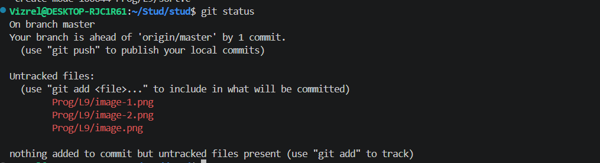
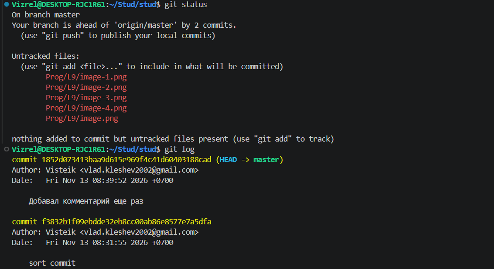
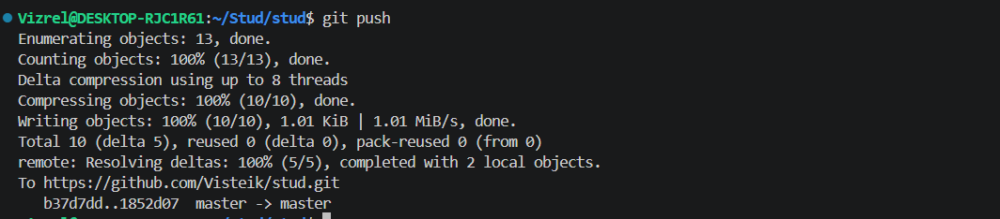
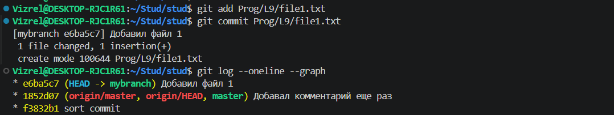
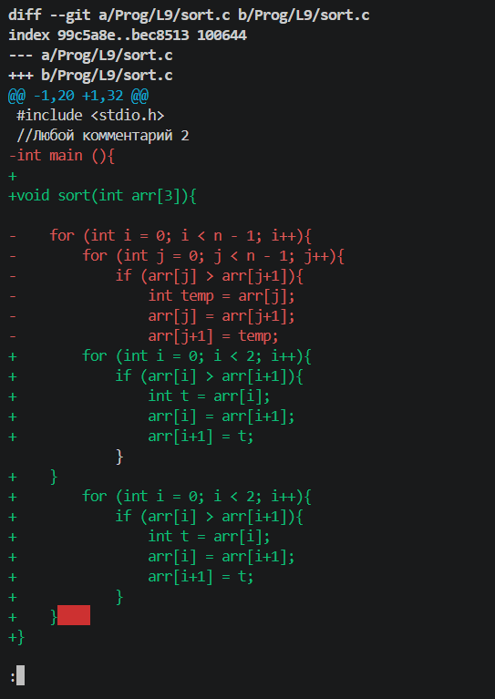
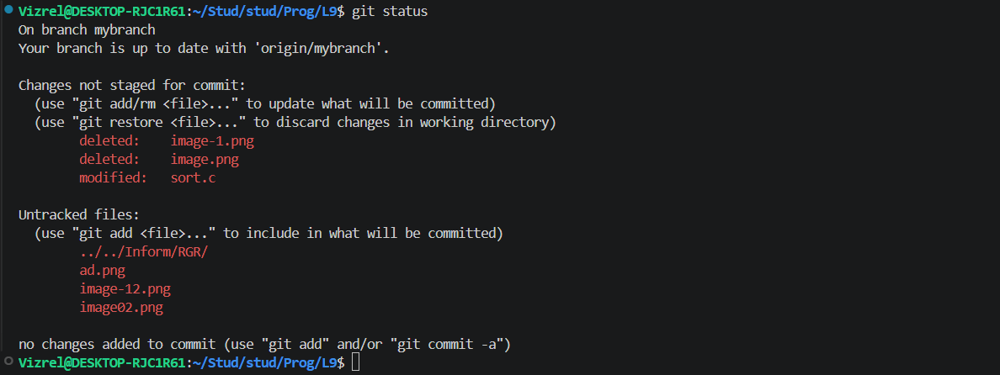
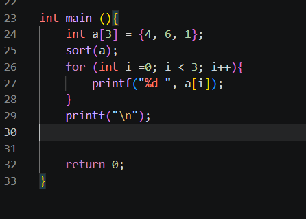
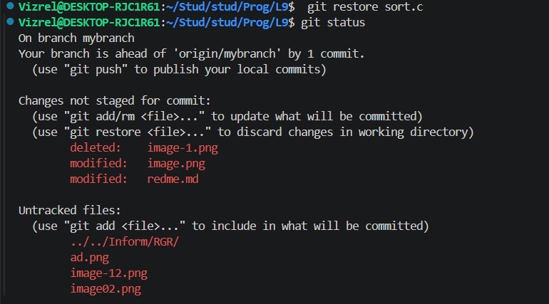

Оценка 3

оценка 3 ветки

оценка 4

git diff --staged пустой

после добавления в staged попали данные в git diff --staged

2 версии файла локально, 1 предзагружена и находится в состоянии stage, с локально внесенными изменениями

теперь сществует только 1 версия файла, хранящаяся локально

лог изменений после коммита сорт

статус после коммита сорт и внесения изменнений в сам файл
старая версия сорт закомитчена и ждет отправки, локально хранится измененная версия

после отката коммита была удалена строка с принтом, т.к. была возвращена выгруженная версия

показывает еще, что существует еще один коммит, но это коммит об откате коммита.
