Оценка 3
Выводим git status, ничего не показывает т.к. изменений нет

Выводим git log, выводит историю коммитов

Создаем файл Sort и выводит статус. Показывает что можем его закомитить

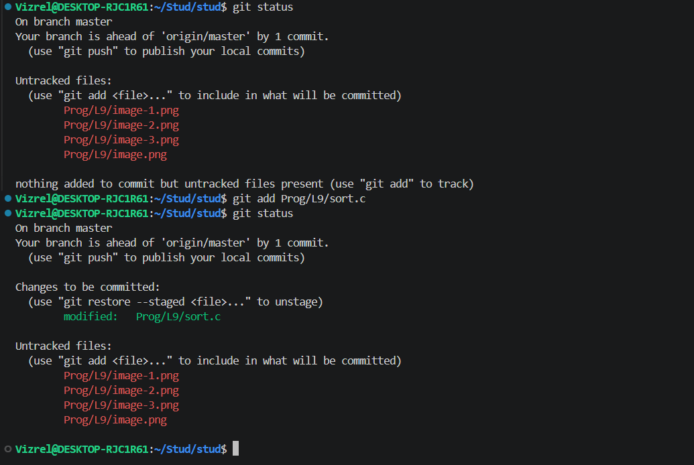

оценка 3 ветки

загрузил ветку mybranch в github

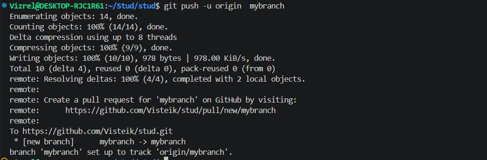

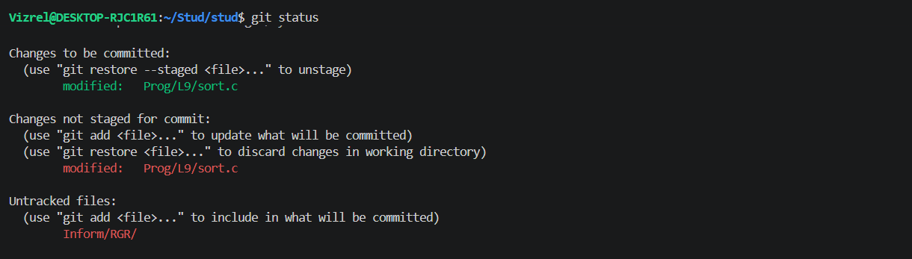
оценка 4

git diff --staged пустой

после добавления в staged попали данные в git diff --staged

2 версии файла локально, 1 предзагружена и находится в состоянии stage, с локально внесенными изменениями

теперь сществует только 1 версия файла, хранящаяся локально
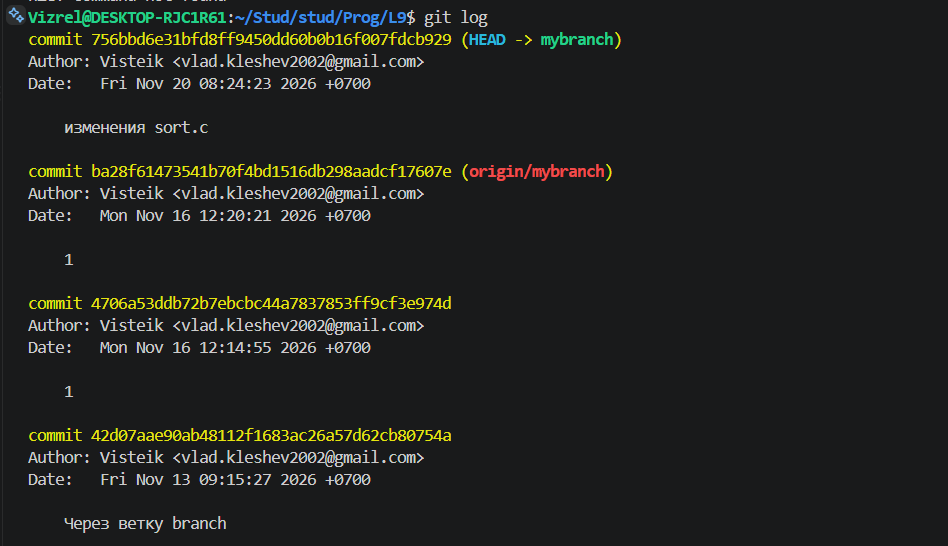
лог изменений после коммита сорт
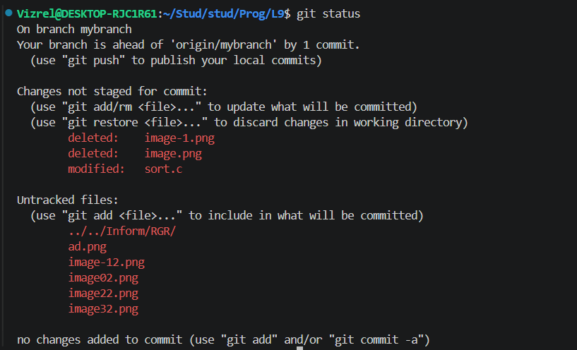
статус после коммита сорт и внесения изменнений в сам файл
старая версия сорт закомитчена и ждет отправки, локально хранится измененная версия

после отката коммита была удалена строка с принтом, т.к. была возвращена выгруженная версия

откатили изменения в файле сорт до предылущей версии. Заккомитченая копия осталась без изменений

ff-merge
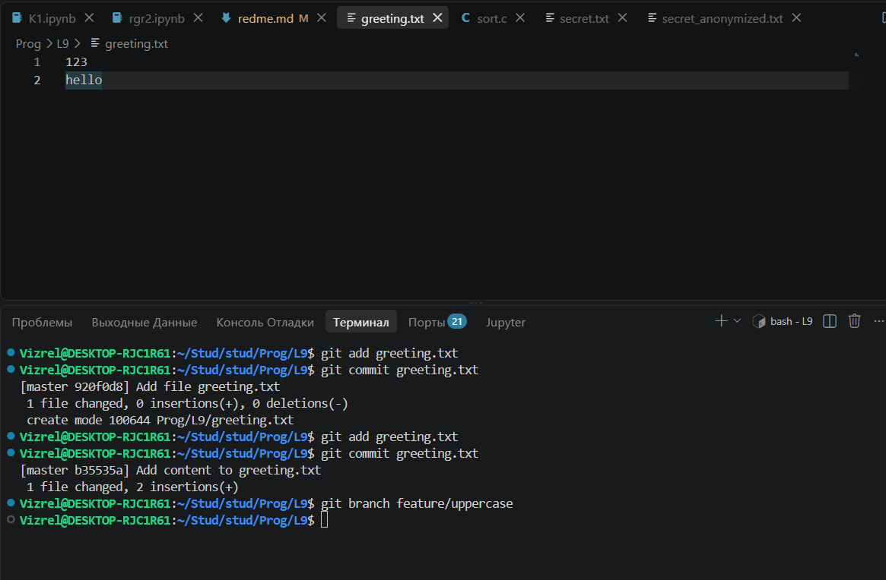
создал файл greeting.txt закомитил и внес изменения и опять закомитил. СОздал ветку feature/uppercase

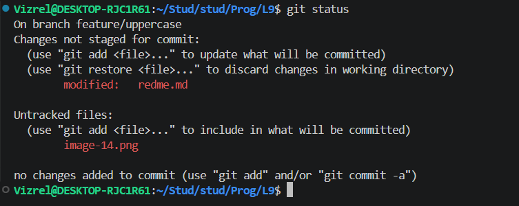
изменения внесенные в ветки master не отображаются
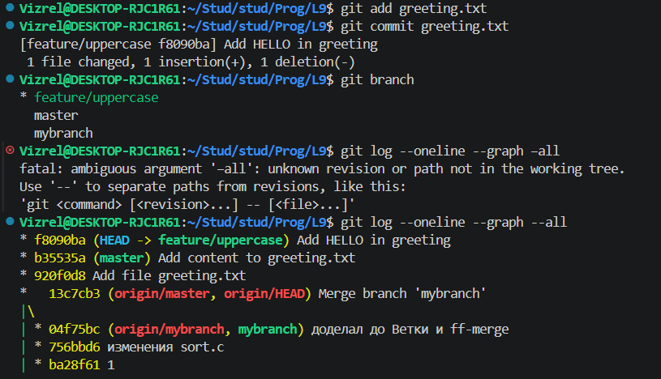
Добавьте файл greeting.txt и закоммитьте
Каков вывод git branch?
Каков вывод git log --oneline --graph –all
Переключитесь на главную ветку

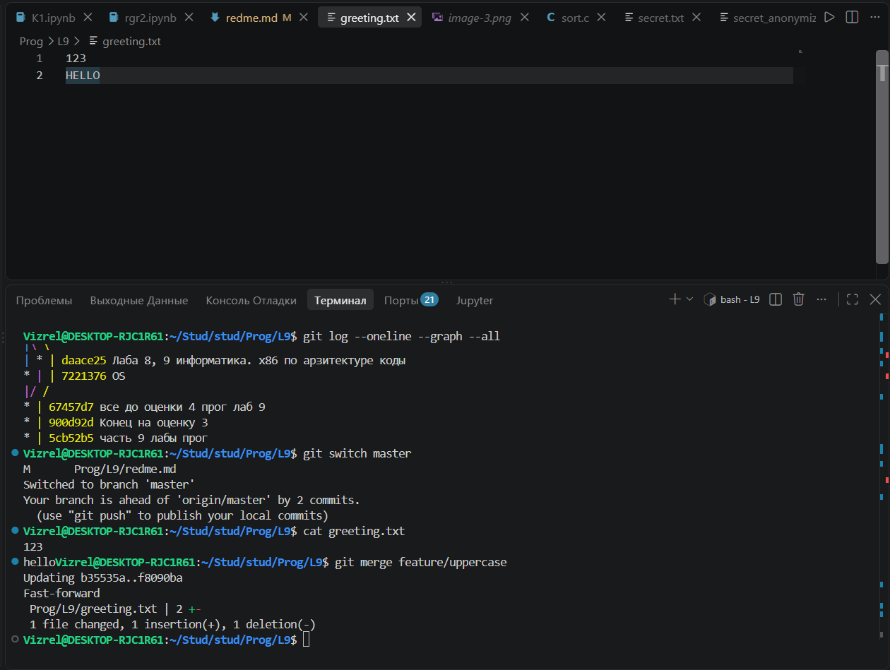
ветка слилась с  мастер

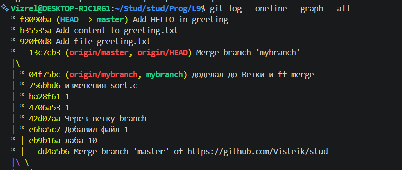
все ветки слиты

на 5
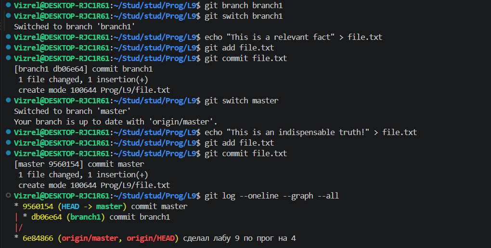
создана ветка branch 1. Выполнена команда echo и  заокмичен файл. Переход в мастер, выполнена echo и закоммичен файл.

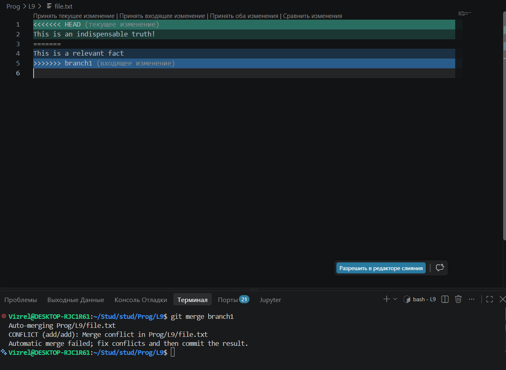
конфликт при слиянии

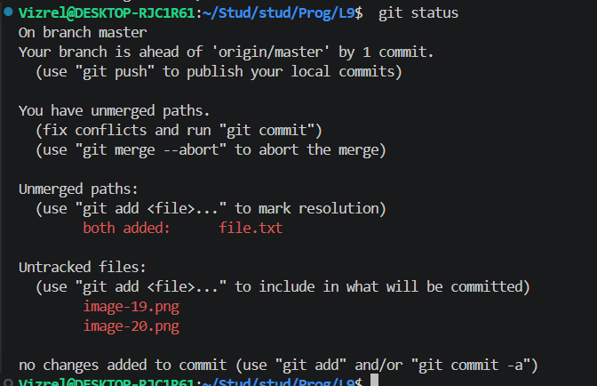
статус слияния 

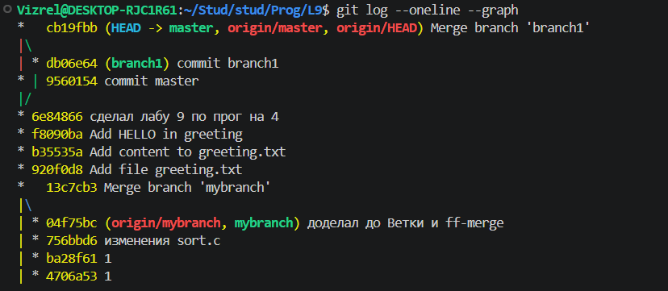
гит лог после коммита 

merge conflict

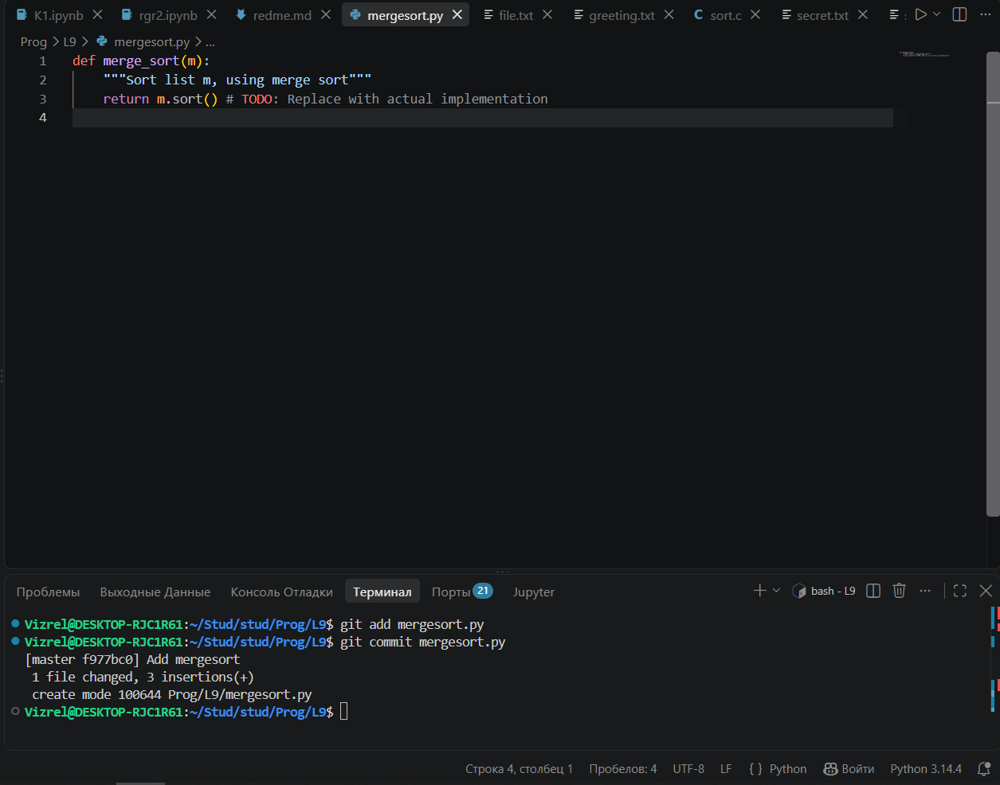
создал mergesort.py и закоммитил

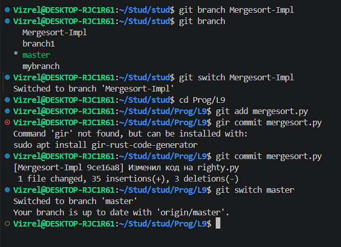
создал ветку Mergesort-Impl, изменил код в файле мержсорт, закоммитил и вернулся в мастер

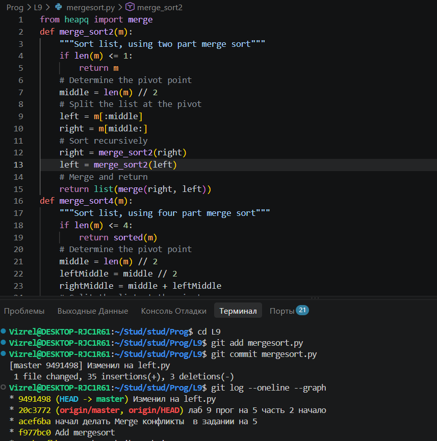
заменил mergesort в мастер и вывел лог

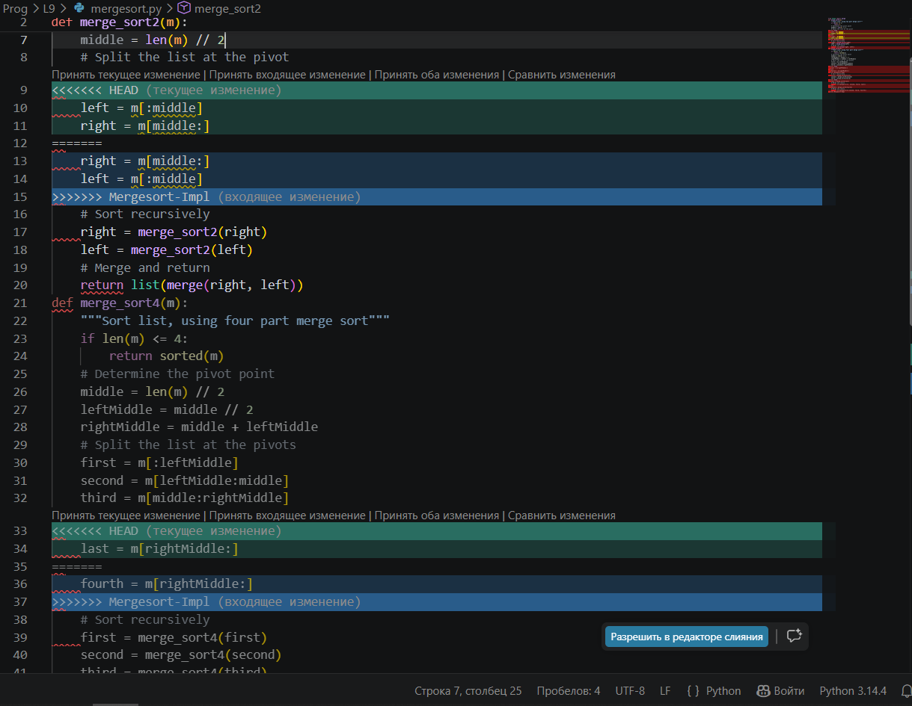
конфликты после мержа

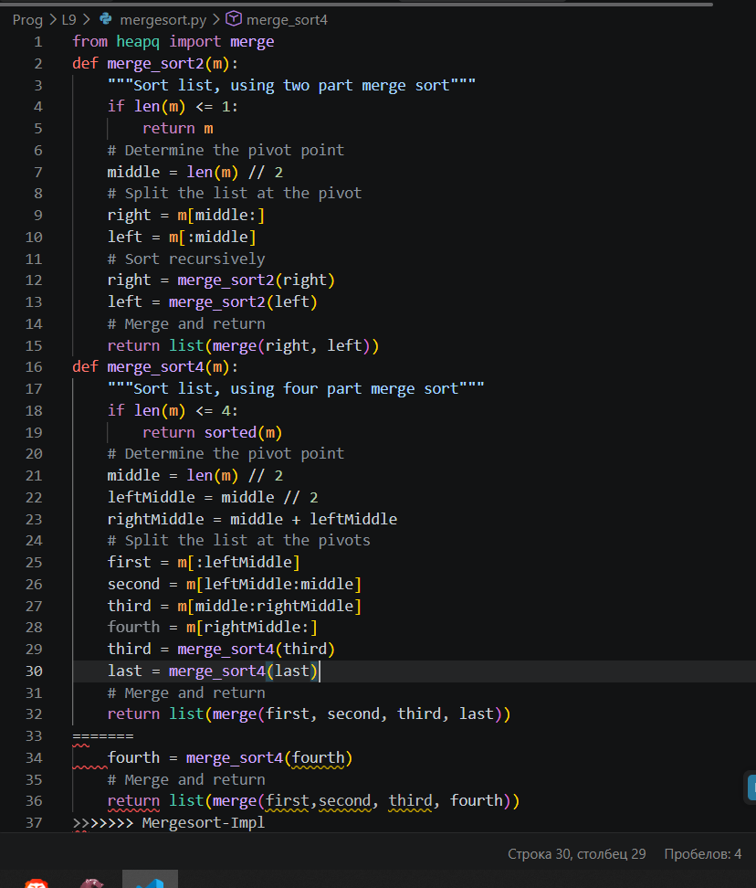
взял изменения из второй ветки